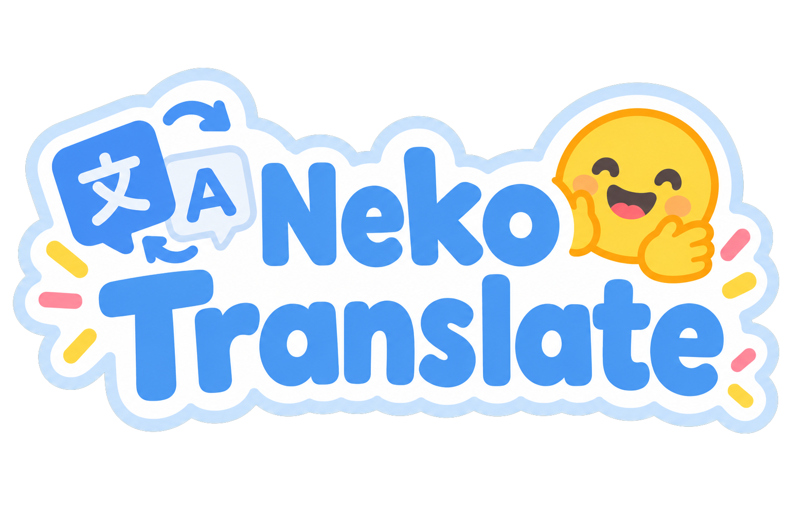

# NekoTranslate

**NekoTranslate** 是一个**完全离线**的 Android 翻译 App：用户自行导入 GGUF 翻译模型，通过 [llama.cpp](https://github.com/ggml-org/llama.cpp) 在手机 CPU 上本地推理。不申请网络权限，数据本地化。

## 支持的模型

| 模型 | 架构（GGUF） | 推荐量化 | 状态 |
|---|---|---|---|
| [Index-Translate-2B](https://huggingface.co/IndexTeam/Index-Translate-2B-GGUF)/[9B](https://huggingface.co/IndexTeam/Index-Translate-9B-GGUF) | `qwen35` | **Q4_K_M** | 内置 Profile |
| [Hy-MT2-1.8B](https://huggingface.co/tencent/Hy-MT2-1.8B-GGUF) / [7B](https://huggingface.co/tencent/Hy-MT2-7B-GGUF) | `hunyuan-dense` | **Q4_K_M** | 内置 Profile |
| 其他 llama.cpp 支持的指令模型 | – | **Q4_K_M** | “Custom” Profile，自按照说明配置 |

- 推荐 **Q4_K_M**：体积、速度、质量最平衡（Index-Translate-2B ≈ 1.3 GB，Hy-MT2-1.8B ≈ 1.1 GB）。
- ⚠️ **Hy-MT2 的 1.25bit / 2bit GGUF 无法加载**：它们依赖腾讯的 STQ 内核（[llama.cpp PR #22836](https://github.com/ggml-org/llama.cpp/pull/22836)），不在 llama.cpp 主线里。请用 Q4_K_M / Q6_K / Q8_0。
- 导入时尽量**保留官方文件名**（如 `Index-Translate-2B.Q4_K_M.gguf`、`Hy-MT2-1.8B-Q4_K_M.gguf`）：自动匹配 Profile 主要靠文件名（`hunyuan-dense` 架构即使改名也会回退到 Hy-MT2）。匹配错了可以在「模型」页手动切换 Profile。
- 9B / 7B 在大内存手机上能跑，但明显慢于 2B / 1.8B。

### 内置 Prompt 与采样参数

| Profile | 用户 Prompt | Chat 包装 | 采样 |
|---|---|---|---|
| Index-Translate | `请将以下{source_lang}文本翻译为{target_lang}，直接输出翻译结果，不要进行任何解释。\n\n{text}`（源语言为“自动”时为 `请将以下文本翻译为{target_lang}，…`），语言名用中文（`英语`、`日语`…） | Qwen3.5 模板、关闭思考：`<\|im_start\|>user\n{prompt}<\|im_end\|>\n<\|im_start\|>assistant\n<think>\n\n</think>\n\n` | temperature 0，max_tokens 1024 |
| Hy-MT2 | 任一侧是中文时：`将以下文本翻译为{target_lang}，注意只需要输出翻译后的结果，不要额外解释：\n\n{text}`；否则：`Translate the following text into {target_lang}. Note that you should only output the translated result without any additional explanation:\n\n{text}` | `<｜hy_begin▁of▁sentence｜><｜hy_User｜>{prompt}<｜hy_Assistant｜>`（无 system prompt） | temperature 0.7, top_p 0.6, top_k 20, repetition_penalty 1.05, max_tokens 4096 |

>来源：[Index-Translate-2B 模型卡](https://huggingface.co/IndexTeam/Index-Translate-2B)、[Index-Translate-2B-GGUF](https://huggingface.co/IndexTeam/Index-Translate-2B-GGUF)、[官方客户端 translate.py](https://github.com/bilibili/Index-Translate/blob/main/inference/llm/translate.py)、[Hy-MT2-1.8B-GGUF 模型卡](https://huggingface.co/tencent/Hy-MT2-1.8B-GGUF)、[Hy-MT2 GitHub](https://github.com/Tencent-Hunyuan/Hy-MT2)、[Hy-MT2 chat_template.jinja](https://huggingface.co/tencent/Hy-MT2-1.8B/blob/main/chat_template.jinja)。

>*为什么不直接用 GGUF 自带的 chat template：*`llama_chat_apply_template` 不执行 Jinja，只按特征识别模板。实测（llama.cpp b11707）它把 Index-Translate 的 Qwen3.5 模板渲染成**不带空 think 块**的 ChatML，把 Hy-MT2 模板误判成 HunyuanVL（渲染成 `<bos>{内容}<｜hy_User｜>`）。所以内置 Profile 使用从官方 Jinja 模板转写的固定包装；Custom Profile 才走 GGUF 模板。

## 开始使用

### **Releases下载（推荐）**
到 [Releases](https://github.com/furina315/NekoTranslate/releases) 页面下载 APK，每个版本有三个：

| 文件 | 适用设备 |
|---|---|
| NekoTranslate-版本-arm64-v8a.apk | **推荐**：64位版本，近几年的设备基本都是 |
| NekoTranslate-版本-armeabi-v7a.apk | 只支持32位的老设备，建议只用≤2B的Q4模型 |
| NekoTranslate-版本-universal.apk | 通用版本，体积更大 |

- **armeabi-v7a 的限制**：32 位进程只有约 3 GB 地址空间，只建议用 ≤2B 的 Q4_K_M 模型（约 1.1–1.3 GB）；7B / 9B 基本无法加载。v7a 只有一个 NEON 版 CPU 后端（没有 dotprod / i8mm 变体和 KleidiAI），速度明显慢于 v8a。

---

### **本地构建**
依赖：JDK 17、Android SDK（compileSdk 37）、NDK **29.0.14206865**、CMake **3.31.6**（可在 SDK Manager 安装，或让 Gradle 自动下载）。

#### 快速开始

```bash
git clone --recursive https://github.com/furina315/NekoTranslate.git
cd NekoTranslate
# clone 时忘了 --recursive：
git submodule update --init --recursive

# 编译 release（日常使用 / 测流畅度请用这个）
./gradlew :app:assembleRelease

# 安装到手机
adb install -r app/build/outputs/apk/release/app-arm64-v8a-release.apk
```

产物位于 `app/build/outputs/apk/release/`，包含 `arm64-v8a`、`armeabi-v7a`、`universal` 三个 APK。

**常用变体**

```bash
# 只编 arm64-v8a（更快）
./gradlew :app:assembleRelease -Plt.abis=arm64-v8a

# 调试版（未混淆，Compose 明显更卡，仅用于调试）
./gradlew :app:assembleDebug
```

> [!NOTE]
> - 原生代码**始终以 Release 编译**（debug APK 也是），否则 llama.cpp 会慢十倍以上。
> - CMake 配置时会通过 FetchContent 下载 KleidiAI，需要联网。

#### 构建参数

在 `gradle.properties` 中配置：

| 参数 | 说明 |
|---|---|
| `lt.cpuAllVariants=true`（默认） | 编出 armv8.0 ~ armv9.2+SME 共 7 个 `libggml-cpu-*.so`，运行时按 CPU 特性自动选最优 |
| `lt.cpuAllVariants=false`<br>`lt.cpuArch=armv8.6-a+dotprod+i8mm+fp16` | 只编一个固定架构，APK 更小、编译更快 |
| `lt.kleidiai=true` | 启用 Arm KleidiAI 内核 |

#### Release 与 Debug

| | Release | Debug |
|---|---|---|
| 包名 | `com.nekohome.translate` | `com.nekohome.translate.debug` |
| 混淆 / 资源压缩 | R8 开启 | 无 |
| Compose 性能 | 带 baseline profile，安装后 AOT 编译 | 未优化，动画明显掉帧 |
| 用途 | 日常使用、测流畅度 | 仅调试 |

两者包名不同，可同时安装（模型需各自导入）。

> [!WARNING]
> Release 目前使用 **debug keystore** 签名，方便 CI 产物直接安装，但**不能用于正式发布**。正式发布前请换成自己的 keystore，换签名后需先卸载旧版。

<details>
<summary>更多构建细节</summary>

- **ABI 与版本号**：编 `arm64-v8a` 和 `armeabi-v7a`（含 universal），minSdk 29（Android 10）。`versionCode = tag 基础值 × 10 + ABI`（universal 0、v7a 1、v8a 2）。
- **baseline profile**：release 通过 `androidx.profileinstaller` 安装 Compose 自带的 profile 和 `app/src/main/baseline-prof.txt`。
- **JNI 混淆规则**：`llama/consumer-rules.pro`，保留 `LlamaNative` 的 native 方法，以及 C++ 通过 `GetMethodID("onToken")` 回调的 `TokenCallback` 及其所有实现。
- **Compose 稳定性配置**：`app/compose-stability.conf`，将只读集合、`File`、`:llama` 模块的数据类标为 stable，列表卡片无变化时跳过重组。

</details>

### CI / Release

| Workflow | 触发条件 | 内容 |
|---|---|---|
| `.github/workflows/ci.yml` | push / PR 到 main | 只编译 Kotlin 并跑 JVM 单元测试（`-Plt.skipNative=true`，不编原生库、不出 APK） |
| `.github/workflows/release.yml` | 推送 `v*` tag 或手动运行 | 编三个 release APK，连同 R8 mapping（`NekoTranslate-<版本>-mapping.txt`，用于还原崩溃堆栈）发布到 GitHub Release |

### 在手机上测试

1. 从 Hugging Face 下载翻译模型到手机。
2. 打开 App →「模型」页 →「导入 .gguf」→ 选文件（复制到 App 私有目录 `files/models`，显示进度并校验 GGUF 头）。
3. 在模型卡片上点「加载」；下方「参数」区可切换 Profile（自动匹配 / 手动 / Custom 模板）、调 temperature、top_p、top_k、重复惩罚、最大长度、上下文长度、线程数（按模型持久化，可一键恢复 Profile 默认值；改上下文 / 线程后会提示重新加载）。
4. 回到「翻译」页 → 选语言 → 输入原文 →「翻译」，可随时「停止」，译文可一键复制。译文下方显示 tokens 数与 tok/s（可在设置里关闭）。
>`adb logcat -s NekoTranslate llama.cpp` 查看原生日志（含选中的 CPU 变体）。

## 架构

```text
app/                              com.nekohome.translate
├── ui/
│   ├── AppRoot                   Material 3 底部导航
│   ├── MainViewModel             三个页面共享，模型跨页面保持加载
│   ├── translate/                翻译页
│   ├── models/                   模型管理 + 参数
│   └── settings/                 设置 + 关于
├── data/
│   ├── ModelProfile / BuiltInProfiles / Language
│   ├── ModelRepository           SAF 导入
│   ├── ModelParams               按模型的参数覆盖（DataStore 持久化）
│   └── SettingsRepository        DataStore
└── engine/
    ├── TranslationEngine         专用单线程执行所有原生调用
    └── 输出清洗、内存统计

llama/                            com.nekohome.translate.llama（Android library + JNI）
├── src/main/cpp/
│   ├── CMakeLists.txt            add_subdirectory(third_party/llama.cpp)
│   └── llama_jni.cpp             只依赖 llama.h 公共 C API
├── LlamaSession
├── LlamaBackend
└── GgufMetadataReader            纯 Kotlin GGUF 头解析

third_party/llama.cpp             git submodule，固定在 b11707
```

### JNI 层能力

- **模型加载**：支持按路径（含 `/proc/self/fd/N`）或文件描述符加载
- **参数设置**：`n_ctx` / 线程数 / batch
- **元数据读取**：GGUF 架构、名称、量化类型、chat template
- **模板应用**：`llama_chat_apply_template`
- **流式生成**：支持 temperature / top_p / top_k / min_p / 重复惩罚，以 UTF-8 字节回调（emoji 安全）
- **控制**：随时取消、卸载
- **性能统计**：返回 prompt 处理耗时与生成速度

## License

Apache-2.0（见 `LICENSE`）。llama.cpp 为 MIT License。模型权重遵循各自许可证。
